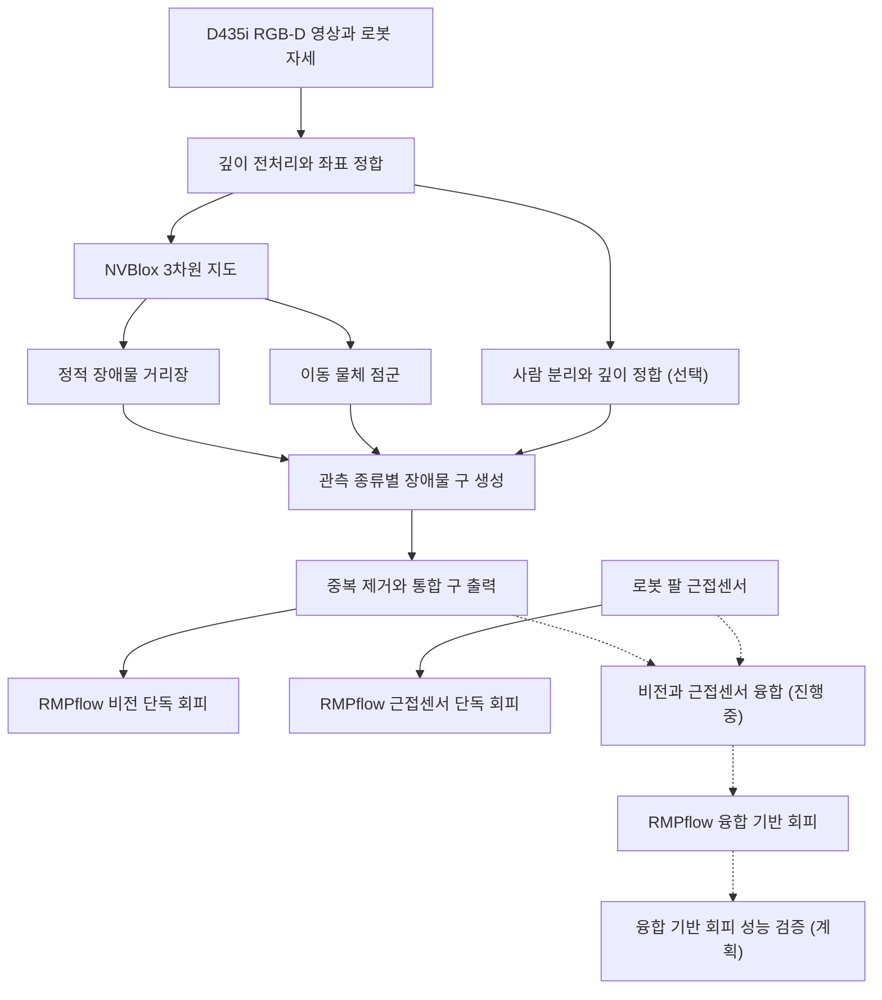

# 로봇 팔 장애물 회피와 RGB-D·근접센서 융합

**학부연구 프로젝트 · RealSense D435i · ROS 2 · NVBlox**

**비전 기반 회피와 근접센서 기반 회피를 RMPflow에서 각각 구현했습니다.** 비전 경로에서는 깊이 카메라로 본 장애물을 중심과 반지름을 가진 구의 집합으로 표현합니다. 현재는 두 센서의 관측을 하나의 회피 입력으로 융합하고 있으며, 최종 목표는 융합 기반 회피의 성능을 검증하는 것입니다.

[전체 연구 흐름](#전체-연구-흐름) · [수행한 점](#수행한-점) · [이룬 점](#이룬-점) · [현재 시도하고 있는 점](#현재-시도하고-있는-점) · [향후 성능 검증](#향후-성능-검증)

## 전체 연구 흐름



**실선**은 구현을 마친 두 단독 회피 경로입니다. **점선**은 진행 중인 센서 융합과 이후 회피 성능 검증을 나타냅니다.

### nvblox 라이브러리와 ROS 2 연동

- **nvblox**는 NVIDIA의 GPU 가속 3차원 지도 라이브러리입니다. 깊이 영상으로 복셀 지도를 구성하고 거리장(TSDF·ESDF)을 갱신합니다. [공식 라이브러리 저장소](https://github.com/nvidia-isaac/nvblox)
- **Isaac ROS nvblox**는 nvblox를 ROS 2에서 사용하는 패키지입니다. `rmp_camera`는 여기서 얻은 정적 ESDF와 이동 물체 점군을 장애물 구로 변환합니다. [공식 ROS 2 패키지 저장소](https://github.com/NVIDIA-ISAAC-ROS/isaac_ros_nvblox)

## 수행한 점

| 작업 | 적용한 방법 |
| --- | --- |
| **정적 거리장을 장애물 구로 변환** | 3차원 거리장(ESDF)에서 장애물 내부로 관측된 격자(복셀)를 연결된 덩어리로 나눴습니다. 표면에서 멀리 떨어진 내부점을 구의 중심 후보로 골랐습니다. |
| **구의 크기와 개수 개선** | 구가 물체보다 크게 만들어지는 문제를 확인했습니다. 물체의 크기와 부분별 폭으로 반지름을 제한하고, 관측된 영역을 충분히 덮는 조건에서 구를 선택·병합했습니다. |
| **이동 물체와 사람 처리** | 이동 물체의 점군과 사람 영역에서 구를 각각 만들었습니다. 구가 겹치면 남길 구가 기존 관측 복셀까지 덮는지 확인한 뒤 중복을 제거했습니다. |
| **로봇 팔의 오검출 처리** | 관절 자세로 계산한 로봇 표면의 예상 깊이를 측정 깊이와 비교했습니다. 팔에 해당하는 관측을 제거하면서 팔 앞쪽의 실제 장애물은 남기도록 했습니다. |

## 이룬 점

| 결과 | 확인 방법 |
| --- | --- |
| **비전 기반 RMPflow 회피 구현** | RGB-D 영상에서 생성한 장애물 구를 RMPflow에 입력해 로봇 팔의 회피를 구현했습니다. |
| **근접센서 기반 RMPflow 회피 구현** | 로봇 팔에 장착된 근접센서의 거리 관측으로 RMPflow 회피를 구현했습니다. |
| **정적·동적·사람 장애물의 통합 출력 구현** | 구의 중심과 반지름을 통합 토픽으로 발행합니다. RViz에서 정적·동적·사람 구와 통합 결과를 확인할 수 있습니다. |
| **장애물 표현을 비교할 기준 마련** | 관측된 복셀을 구가 덮는 비율, 구의 개수·크기·중첩, 처리시간을 비교할 수 있도록 실험 설정과 진단 출력을 구성했습니다. |
| **같은 관측으로 반복 비교 가능** | 기록한 센서 데이터(rosbag)를 다시 재생하고, YAML의 설정을 바꿔 비교할 수 있도록 재생과 검증 도구를 구성했습니다. |

**개발 이력** · [정적 구 구현](https://github.com/alswoxoghd1/rmp_camera/pull/1) · [동적 구 개수와 중첩 개선](https://github.com/alswoxoghd1/rmp_camera/pull/2) · [로봇 자기 제거와 사람 처리 개선](https://github.com/alswoxoghd1/rmp_camera/pull/3)

## 현재 시도하고 있는 점

| 과제 | 진행 상태 | 내용 |
| --- | --- | --- |
| **카메라와 근접센서 융합** | 진행 중 | 같은 장애물을 관측한 경우 두 센서의 값을 근접센서 방향의 표면 거리로 맞추고, 측정 불확실성이 작은 쪽에 더 큰 가중치를 주는 방식을 검토하고 있습니다. 카메라가 가려져 근접센서만 유효한 경우의 처리도 함께 고려합니다. |
| **깊이와 좌표변환 오차 보정** | 방법 조사 | 깊이값의 편향과 카메라에서 로봇 기준 좌표로 옮길 때 생기는 오차를 나눠 보고, 각각의 보정 방법을 조사했습니다. |

## 향후 성능 검증

1. 센서 융합이 완성되면 융합 결과를 RMPflow에 입력해 **센서 융합 기반 회피**를 구현합니다.
2. 같은 실험 조건에서 **비전 단독·근접센서 단독·센서 융합**의 회피 성능을 비교합니다. 가림 여부에 따른 반응시간, 최소 이격거리, 회피 성공률을 확인할 계획입니다.

## 실행과 재현

<details>
<summary>실행 명령과 검증 도구 보기</summary>

아래 명령은 이 저장소의 RGB-D 인식과 장애물 구 출력을 실행합니다. ROS 2 Humble에서 RealSense와 NVBlox를 설정하고 패키지를 빌드한 뒤, 워크스페이스를 활성화합니다.

```bash
# 카메라 입력과 RViz 시각화
ros2 launch rmp_camera d435_nvblox_dynamic_spheres.launch.py \
  source:=camera run_rviz:=true

# 기록한 센서 데이터 재생
ros2 launch rmp_camera d435_nvblox_dynamic_spheres.launch.py \
  source:=bag bag_path:=/path/to/recording run_rviz:=true
```

- **실험 설정** · [통합 실험 YAML](config/d435_nvblox_dynamic_experiment.yaml)
- **비교 및 진단** · [재생 검증](scripts/validate_static_clear_replay.py) · [구 생성 비교](scripts/benchmark_local_width_cover.py)
- **핵심 코드** · [정적 구 생성](rmp_camera/esdf_medial_sphere_core.py) · [동적 구 생성](rmp_camera/dynamic_obstacle_sphere_core.py) · [구 통합](rmp_camera/obstacle_sphere_fusion_node.py)

</details>
